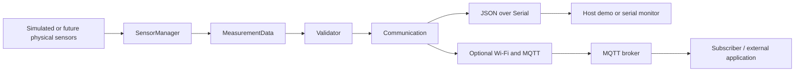

# Architecture

## Data path



## Responsibilities

- `SensorManager` returns all four values in one reading. Included ESP32 implementation is simulation-only.
- `MeasurementData` is the shared record with a monotonic milliseconds-since-boot timestamp and `valid` flag.
- `Validator` checks finite values and broad engineering limits. These detect implausible input; they are not crop setpoints.
- `Communication` serializes JSON and prints it. With `ENABLE_MQTT`, it also publishes to `microhydros/measurement` while connected.
- `main.cpp` schedules a reading every five seconds without waiting for the interval in a blocking delay.

## Example payload

```json
{"timestamp_ms":5000,"air_inside_c":22.25,"air_outside_c":18.15,"water_c":20.1,"humidity_inside_pct":56.5,"valid":true}
```

The firmware timestamp is not wall-clock time. A production service should add synchronized UTC time and device identity, version the schema, and address authentication, TLS, offline buffering, and retention.

## Failure behavior

Invalid readings are still emitted with `valid: false` so a receiver can observe faults. Failed MQTT publication is not queued for later delivery. The next scheduled cycle continues. The host demo's `--invalid-every` option exercises this path.